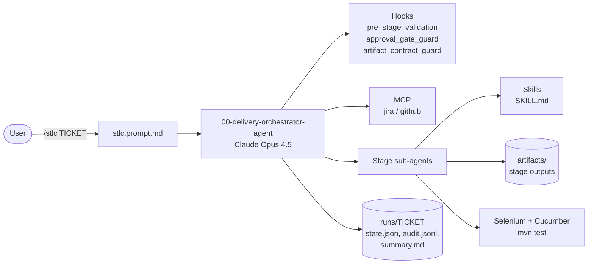
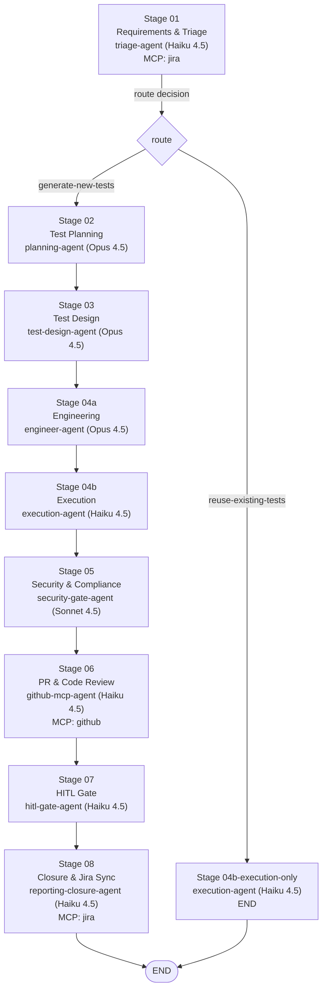
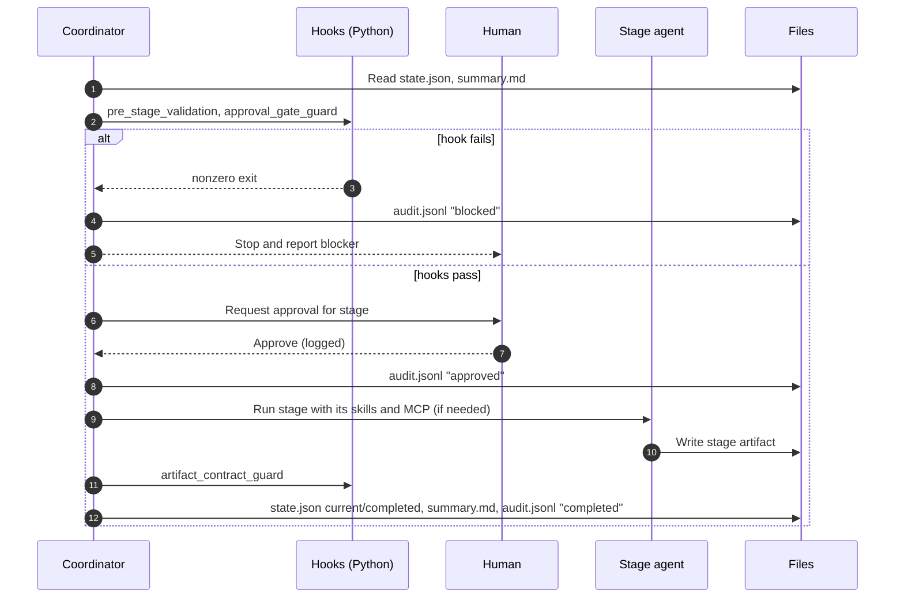
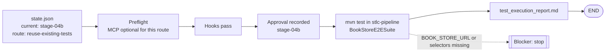

# STLC Pipeline Architecture

Source of truth: `.github/config/project.json` (manifest) and `stlc-pipeline/workflow/STLCWorkflowOrchestrator.java` (stage order, routing, approval flags).

## 0. At a glance (plain text)

```
 /stlc TICKET
      |
      v
 +------------------------------+
 | 00 Orchestrator (coordinator)|---- reads state.json, summary.md
 +------------------------------+
      |  for each stage, in order:
      v
 [pre-checks] --fail--> STOP (audit: blocked)
      | pass
      v
 [human approval] --none--> WAIT
      | approved
      v
 [stage agent + skill + MCP if needed] --> stage artifact
      |
      v
 [artifact_contract_guard] --fail--> RETRY (max 3) --> ESCALATE
      | pass
      v
 [state.json + summary.md + audit.jsonl] --> next stage

 ROUTE after Stage 01 (triage):
   reuse-existing-tests --> 04b Execution only --> END
   generate-new-tests   --> 02 -> 03 -> 04a -> 04b -> 05 -> 06 -> 07 -> 08 -> END

 CURRENT RUN  EPMCDMETST-66524
   state: stage-04b | route: reuse-existing-tests
   blocker: BOOK_STORE_URL + 5 selectors not set
```

## 0a. Target end-to-end flow

```
+------------------------------------------------------------------+
|                 JIRA STORY / BUG TICKET                          |
+---------------------------------+--------------------------------+
                                  | (Jira MCP config)
                                  v
+------------------------------------------------------------------+
| 1. Requirements Analysis      [ Triage Agent ]                   |
|    route: reuse-existing-tests ? (see branch below)              |
+---------------------------------+--------------------------------+
                                  v
+------------------------------------------------------------------+
| 2. Test Strategy & Plan       [ Planning Agent ]            |
+---------------------------------+--------------------------------+
                                  v
+------------------------------------------------------------------+
| 3. Test Case Generation       [ Test Design Agent ]              |
+---------------------------------+--------------------------------+
                                  |--> Outputs: BDD / JUnit / Allure
                                  v
+------------------------------------------------------------------+
| 4. Dev & Self-Healing         [ Engineer & Execution Agent ]     |
+---------------------------------+--------------------------------+
                                  v
+------------------------------------------------------------------+
| 5. Security & Compliance      [ SAST / SCA Gate ]                |
+---------------------------------+--------------------------------+
                                  v
+------------------------------------------------------------------+
| 6. Auto PR & Review           [ GitHub MCP Agent ]               |
+---------------------------------+--------------------------------+
                                  | (GitHub MCP config)
                                  v
+------------------------------------------------------------------+
| 7. Human-in-the-Loop          [ HITL Approval Gate ]             |
+---------------------------------+--------------------------------+
                                  v
+------------------------------------------------------------------+
| 8. Closure & Deployment       [ Jira Sync & Reporting ]          |
+------------------------------------------------------------------+

Reuse branch (decided at Stage 1, when existing tests are found):
   Stage 1 --> Stage 4b (execution only) --> Stage 8 closure report
   Skips Stages 2, 3, 4a. Stage 4b for EPMCDMETST-66524 is the current step.
```

Notes on this flow:
- Each stage is gated: pre-checks, human approval, then the stage agent writes its artifact before the next stage starts.
- Stages 5 to 8 run only on the new-test route as currently configured. Stage 8 runs closure on both routes in your diagram; confirm this before we change the manifest.

## 1. Components



## 2. Stage graph



## 3. Stage table

| Stage | Agent | Artifact | Approval before start | Hooks | Depends on |
|---|---|---|---|---|---|
| 01 Requirements & Triage | triage-agent | `requirement_analysis.md` | Yes | pre_stage, artifact_contract | none |
| 02 Test Planning | planning-agent | `test_planning.md` | Yes | pre_stage, artifact_contract | 01 |
| 03 Test Design | test-design-agent | `test_design.md` | Yes | pre_stage, artifact_contract | 02 |
| 04a Engineering | engineer-agent | `engineering_summary.md` | Yes | pre_stage, approval_gate | 03 |
| 04b Execution | execution-agent | `test_execution_report.md` | Yes | pre_stage, approval_gate | 04a |
| 04b-execution-only | execution-agent | `test_execution_report.md` | Yes | pre_stage, approval_gate | 01 (reuse route) |
| 05 Security & Compliance | security-gate-agent | `security_compliance_report.md` | Yes | pre_stage, approval_gate | 04b |
| 06 PR & Code Review | github-mcp-agent | `pr_review_summary.md` | Yes | pre_stage, approval_gate | 05 |
| 07 HITL Gate | hitl-gate-agent | `hitl_audit_trail.md` | No | pre_stage, approval_gate | 06 |
| 08 Closure & Jira Sync | reporting-closure-agent | `test_closure_metrics.md` | Yes | pre_stage, artifact_contract | 07 |

Configured approval gates in the manifest: `design-approval` and `execution-approval`.

## 4. Per-stage sequence



Retry rule: at most 3 attempts per stage. After 3 failures the coordinator stops and escalates.

## 5. Execution route for EPMCDMETST-66524



## 6. Configuration and secrets

- Tokens come only from environment variables. `stlc-pipeline/.env` holds `GITHUB_TOKEN` and `ATLASSIAN_BASIC_AUTH`; its values are never printed or written to artifacts.
- E2E settings come from environment variables: `BOOK_STORE_URL`, `BOOK_STORE_SEARCH_INPUT`, `BOOK_STORE_SEARCH_BUTTON`, `BOOK_STORE_DETAIL_CONTAINER`, `BOOK_STORE_EMPTY_MESSAGE`, `BOOK_STORE_EXPECTED_DETAILS`.
- Models are pinned per subagent in each agent's frontmatter and must not change mid-run.

## 7. Run artifacts

```
stlc-pipeline/artifacts/
  requirement_analysis.md, test_planning.md, test_design.md,
  engineering_summary.md, test_execution_report.md,
  security_compliance_report.md, pr_review_summary.md,
  hitl_audit_trail.md, test_closure_metrics.md
  runs/<TICKET>/
    state.json      current stage, route, approvals, blocker
    audit.jsonl     one event per stage: started / approved / completed / blocked
    summary.md      rolling 5-line summary (rewritten at each stage end)
    usage.jsonl     recorded token usage events (optional)
```

## 8. Open items

- `UsageDashboard.java` compile result is not yet confirmed; `usage_dashboard.py` still needs deletion.
- Python hooks (`.github/hooks/*.py`) are still in use; porting them to Java is pending.
- Stage 4b cannot run until `BOOK_STORE_URL` and the five selector variables are set.
