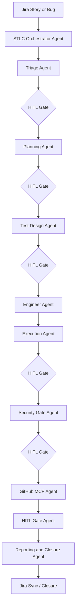

# EPAM STLC Enterprise Multi-Agent System

This repository defines an 8-stage STLC workflow for GitHub Copilot, with custom
agents, Agent Skills, prompt-file entry points, validation scripts, and human
approval gates.

## Structure

- `.github/agents/` holds Copilot custom agents (`*.agent.md`)
- `.github/skills/` holds reusable Agent Skills (`<name>/SKILL.md`)
- `.github/prompts/` holds Copilot prompt-file entry points (`*.prompt.md`)
- `.github/config/` holds the workflow manifest and integration references
- `.github/hooks/` holds Python validation scripts, not Copilot lifecycle hooks
- `stlc-pipeline/artifacts/` holds the phase outputs for all 8 STLC stages
- `stlc-pipeline/workflow/` holds the Java orchestration entrypoint for the multi-agent STLC flow

## Agent Model

- Main orchestrator: `.github/agents/00-delivery-orchestrator-agent.agent.md`
- Stage agents: numbered `.github/agents/*.agent.md` files, ordered by workflow stage
- Reusable skills: `.github/skills/*/SKILL.md`
- VS Code Local prompt entry points: `.github/prompts/*.prompt.md`
- Validation scripts: `.github/hooks/*.py`

VS Code Agent Host does not load prompt files. In Agent Host sessions, invoke
the orchestrator custom agent directly; use prompt-file slash commands only
with the VS Code Local agent.

Copilot customization support differs by IDE and version. GitHub currently
marks custom agents, Agent Skills, and prompt files as preview in JetBrains;
check the [Copilot feature matrix](https://docs.github.com/en/copilot/reference/copilot-feature-matrix)
before relying on a feature in IntelliJ or another IDE.

## Command Package

- `.github/prompts/stlc.prompt.md` (or `00-stlc-pipeline.prompt.md`) selects the orchestrator.
- `.github/prompts/*-*.prompt.md` files expose stage-specific entry points.
- Copilot loads reusable capabilities as Agent Skills; do not invoke a textual `Skill:` block as a tool.

## End-to-End Flow

1. Stage 1 ingests Jira requirements and produces requirement analysis.
2. Stage 2 turns approved analysis into a risk-based plan.
3. Stage 3 generates BDD and test design assets.
4. Stages 4a and 4b sequence automation engineering before approved test execution.
5. Stage 5 applies security and compliance review.
6. Stage 6 prepares PR and automated review actions.
7. Stage 7 enforces human approval and records the audit trail.
8. Stage 8 prepares closure metrics and Jira sync-ready outputs.

## Architecture Diagram

## MCP Integrations

- Integration templates: `.github/config/mcp/`
- Templates do not mean the MCP tools are configured or connected in the active Copilot session.

## HITL Gates

- Human approval is required before each execution-bearing phase.
- Stage 7 is the explicit audit and approval checkpoint.
- Human approval is enforced by workflow instructions and validation scripts; the
  Python scripts are invoked explicitly, not as Copilot lifecycle hooks.

## Security Posture

- Live integrations remain disabled by default.
- Secrets are stored as references only.
- Repository mutation, scan execution, PR creation, and Jira sync require explicit approval.
- Evidence artifacts are required for downstream progression.

## Live Demo Path

Use the orchestrator with placeholder Jira and GitHub inputs to demonstrate:

1. intake into `stlc-pipeline/artifacts/requirement_analysis.md`
2. phase-by-phase artifact generation through all 8 stages
3. HITL stop/go control at each gated transition
4. final closure output in `stlc-pipeline/artifacts/test_closure_metrics.md`

## Demo Dashboard

- Demo report: `stlc-pipeline/artifacts/stlc_dashboard_demo.html`
- Sample data contract: `stlc-pipeline/artifacts/dashboard_data.sample.json`
- The HTML report is intentionally standalone so it can be opened directly in a browser during a demo.
- For live demos, the executor can inject real telemetry into `window.STLC_DASHBOARD_DATA` or generate the same JSON shape before opening the report.
- Token usage is currently sample data only and should be replaced by runtime telemetry when available.

## Legacy Claude Code token dashboard

`stlc-pipeline/workflow/token_dashboard.py` and `stlc-pipeline/workflow/test_token_dashboard.py` are retained
as a legacy Claude Code utility. They read Claude-specific transcript data and
are not invoked by Copilot. Do not report their output as Copilot telemetry.
The standalone demo dashboard remains sample data, not runtime evidence.

Removed legacy content:

- root-level `config/`, `docs/`, `hooks/`, `mcp/`, `skills/`, and `stages/`
- duplicate agent package trees from the previous Claude layout
- generated build output under `target/`

## Human-in-the-Loop Policy

- No live integration is enabled by default
- Human approval is required before stage execution, repository mutation, PR creation, or Jira synchronization
- Placeholder values are used until you provide real Jira, GitHub, and scanner details

## Current Status

- `.github/config/project.json` is the active flow manifest
- `.github/agents/00-delivery-orchestrator-agent.agent.md` is the main coordinator
- `stlc-pipeline/workflow/STLCWorkflowOrchestrator.java` is the active stage graph source
- `stlc-pipeline/artifacts/` files are the phase outputs the runtime can populate
- agent execution requires Copilot custom-agent and enabled MCP capabilities
