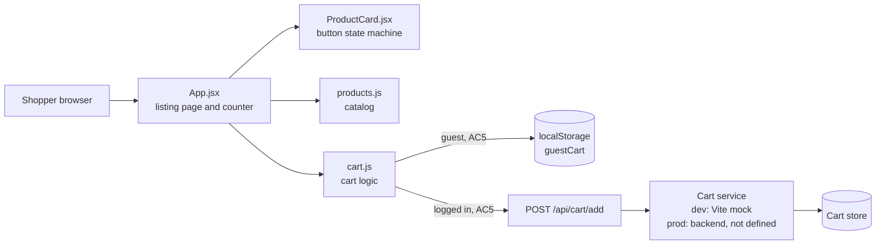
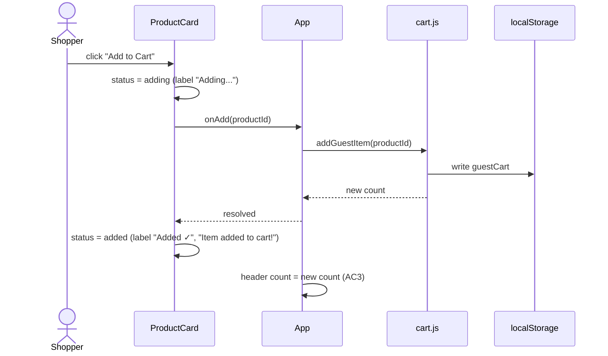
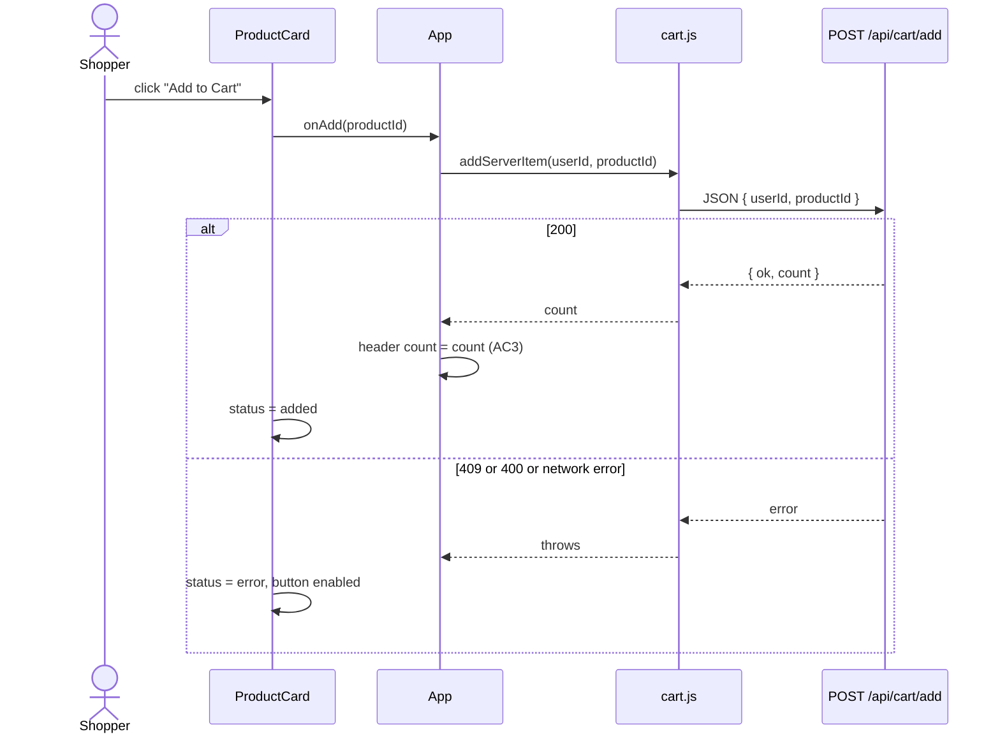
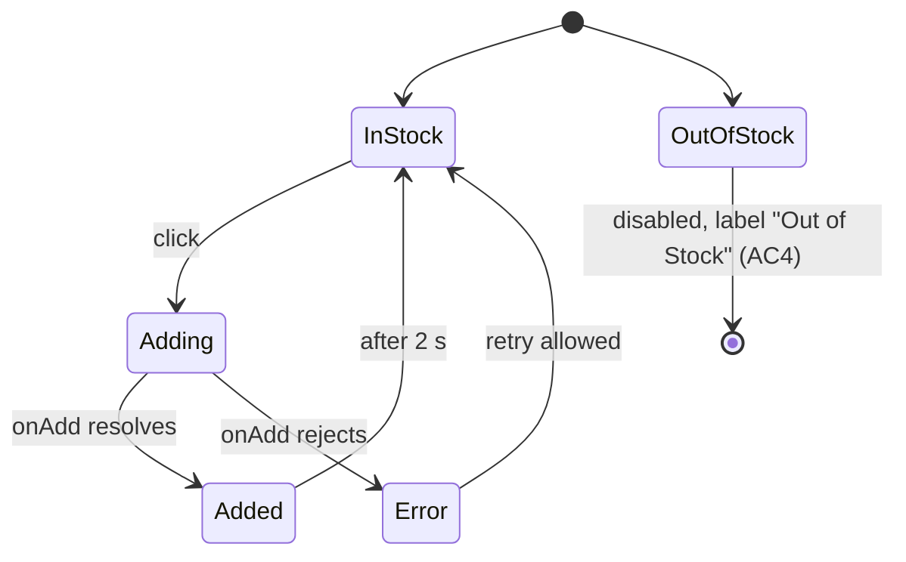

# Architecture and Development Design: Add to Cart on Product Listing

Story: Add "Add to Cart" Button on Product Listing Page (Epic: Shopping Cart & Checkout)
Ticket: EPMCDMETST-70442 (requirement text supplied by user; Jira read not verified)
Stage: 2, design before development.
Status: design updated to match the built web app; awaiting Stage 2 approval.
Source of acceptance criteria: user-supplied story text. IDs AC1 to AC5 are assigned here in story order.

## 0. Acceptance criteria (as referenced below)

| ID | Criterion (from story) |
|---|---|
| AC1 | An "Add to Cart" button is displayed on every product card in the listing. |
| AC2 | Clicking it adds the item to the user's cart, and shows feedback ("Item added to cart!" or "Added ✓"). |
| AC3 | The header cart counter updates in real time to the new item count. |
| AC4 | An out-of-stock product has a disabled button labelled "Out of Stock". |
| AC5 | Guest items are stored in local storage; logged-in items sync to the backend via `/api/cart/add`. |

## 1. Scope

In scope: AC1 to AC5 as above, and the unit tests that cover them.

Out of scope: checkout, payment, login UI, a real inventory service, and the OrangeHRM e2e path.

## 2. Architecture

Components:

| Module | Responsibility | Depends on | Criteria |
|---|---|---|---|
| `App.jsx` | Listing page, header counter, routes the add to guest or server cart | `cart.js`, `products.js`, `ProductCard.jsx` | AC1, AC3, AC5 |
| `ProductCard.jsx` | One product: name, price, button state machine, feedback | `onAdd` prop only | AC1, AC2, AC4 |
| `cart.js` | Guest cart read and write, server add call, item count | `window.localStorage`, `fetch` | AC2, AC3, AC5 |
| `products.js` | Catalog data: id, name, price, stock | none | AC4 |
| `server/cartApiMock.js` | Dev-only stand-in for `/api/cart/add` (not production code) | Vite dev server | AC5 |
| `vite.config.js` | Dev server on 127.0.0.1:5173; Vitest and coverage config | Vite, Vitest | all (test and run) |

## 3. Interfaces

### 3.1 `POST /api/cart/add`

| Item | Value |
|---|---|
| Request body | `{ "userId": string, "productId": string }` |
| 200 | `{ "ok": true, "count": number }` (total items in the user's cart) |
| 400 | `{ "error": string }` (missing `userId`, unknown `productId`, or invalid JSON) |
| 409 | `{ "error": "Out of stock" }` |
| 405 | Non-POST request (empty body) |

### 3.2 Guest cart storage

- Key: `guestCart` in `window.localStorage`.
- Value: JSON object `{ [productId]: quantity }`.
- Count: sum of all quantities.

## 4. Sequence: add to cart

Guest flow (AC2, AC3, AC5):

Logged-in flow (AC5):

## 5. State and behaviour

Button state machine (`ProductCard`):

Product stock is read from `products.js` (AC4) on the client. The server also returns 409 when stock is zero.

## 6. Error handling

- Corrupt `guestCart` JSON in localStorage: treated as an empty cart. The next add overwrites it.
- Server 4xx or 5xx, or network failure: the card shows "Could not add item. Try again." and the button stays enabled.
- Out of stock: checked on the client (AC4) and on the server (409).

## 7. Non-functional requirements

| Area | Requirement |
|---|---|
| Accessibility | Feedback uses `role="status"` (success) and `role="alert"` (error). The header counter has `aria-label="cart count"`. |
| Feedback timing | The added state reverts to "Add to Cart" after 2 seconds. |
| Environment | Dev server on `127.0.0.1:5173`. The API is a dev mock; no production endpoint is configured. |
| Test tooling | Vitest with jsdom and Testing Library; v8 coverage. |

## 8. Test approach (input to Stage 3)

Unit tests are written after the page is built. Each test cites its criterion.

| Test area | Criteria | Notes |
|---|---|---|
| Card in stock: enabled button | AC1 | |
| Card out of stock: disabled, "Out of Stock" | AC4 | |
| Card success: "Added ✓" and message | AC2 | |
| Card failure: alert, button enabled | AC2 | |
| Guest cart storage and count | AC5 | |
| Header counter after guest add | AC3 | |
| Header counter after logged-in add, mocked `fetch` | AC3, AC5 | |

Coverage target: 90% statements on `src/`, measured by `npm run test:coverage`.

## 9. Development plan (ordered)

Status is as built in `webapp/`. Steps 1 to 4 are implemented; their unit tests are part of step 5.

1. Catalog data and cart logic (`products.js`, `cart.js`). Built.
2. Product card with button state machine (`ProductCard.jsx`). Built.
3. Listing page and header counter (`App.jsx`, `main.jsx`). Built.
4. Dev API mock (`server/cartApiMock.js`) and Vite wiring (`vite.config.js`). Built.
5. Unit tests (Stage 3), coverage run (Stage 4b), review (Stage 5), PR (Stage 6). Tests written and passing (7 tests). Coverage 94% statements; `cart.js` lines 8-9 and 36-39 are not covered.

## 10. Risks and open items

- The `/api/cart/add` service is a dev mock. The real service URL, authentication, and schema are not confirmed.
- The logged-in user identity is passed as a prop. The real login source is not defined.
- The out-of-stock source of truth (catalog service or stock API) is not defined. Stock is static data today.
- Acceptance criteria come from the user's text, not from Jira. The Jira connection is not verified.
- Coverage gap: corrupt guest cart handling and server error handling in `cart.js` have no tests yet.
- The header counter is a plain text value; there is no cart icon.

## 11. Traceability

| Criterion | Design element | Test (Stage 3) |
|---|---|---|
| AC1 | `ProductCard` rendered for each item in `PRODUCTS` | in stock: enabled button |
| AC2 | Button states `adding`, `added`, `error`; `onAdd` | success and failure states |
| AC3 | `App` count state from `addGuestItem` or `addServerItem` | header counter tests |
| AC4 | `ProductCard` `outOfStock` check; server 409 | out of stock test |
| AC5 | `cart.js` `guestCart` key; `addServerItem` to `/api/cart/add` | guest storage test; logged-in test with mocked `fetch` |

## 12. Approval

| Field | Value |
|---|---|
| Design approved by | pending |
| Date | pending |
| Decision | pending (go / no-go for Stage 3) |
